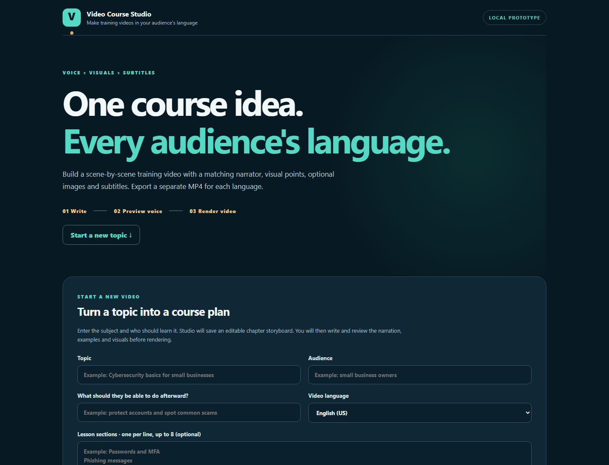
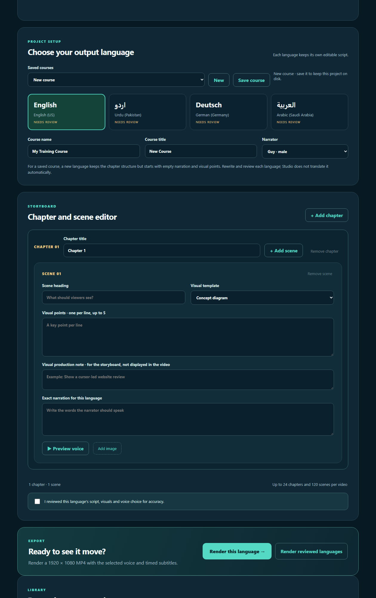

# Video Course Studio

Video Course Studio is a **local prototype** for making narrated, 1920 × 1080 training videos. It currently supports English (US), Urdu (Pakistan), German (Germany), and Arabic (Saudi Arabia), with male and female voice choices. Each reviewed language produces a **separate MP4** with burned-in captions, an SRT download, and WebVTT captions for the local viewer.

## Interface preview



<details>
<summary><strong>View the language and storyboard editor</strong></summary>



</details>

## Start

Use Python 3.12 or newer. On a fresh checkout, install the dependencies first:

```powershell
python -m venv .venv
.venv\Scripts\python.exe -m pip install -r requirements.txt
.venv\Scripts\python.exe app.py
```

On an existing setup with dependencies already installed, run [Start Video Course Studio.cmd](Start%20Video%20Course%20Studio.cmd), or from this directory:

```powershell
python app.py
```

Open <http://127.0.0.1:8765/>. Keep the server running while rendering or using the local viewer. FFmpeg is supplied by `imageio-ffmpeg`. Voice generation requires internet access to its speech service.

## Make a multilingual course

1. For a **new topic**, use **Turn a topic into a course plan**. Enter the topic, audience, learning goal, language, and optionally up to eight lesson sections. Studio saves an editable introduction, three teaching scenes per section (what/why, practical method/example, mistakes/best practices), and an action-plan ending. Without section names it uses three general planning sections. This is a storyboard scaffold; narration is intentionally blank and must be written and reviewed before rendering.
2. Arrange up to **24 chapters and 120 scenes** in one language, and edit their headings, visual points, narration, and voice. Add your own images where useful. The five visual templates are diagram, process flow, checklist, comparison, and photo. Older saved courses open as one chapter.
3. Preview the narrator. Check the **reviewed** box only after the words, visuals, role of the learner, claims, and pronunciation are correct. Edits to that language clear the review flag.
4. Switch languages and write each version separately. For a saved course, a new language copies the chapter structure with empty narration and visuals for you to localize. Changing language **does not translate** your writing.
5. Save the course to keep every language draft on this computer. The project menu can reopen it after restarting the browser or server, and a browser refresh resumes the current working draft. Revision checks prevent one stale editor tab from silently overwriting a newer save.
6. Choose **Render this language** or **Render reviewed languages**. The latter queues a separate video for every reviewed language. Progress and completed results are saved on disk and can be recovered after a page refresh. A render interrupted by closing the server must be started again.
7. Open the completed batch's **language chooser** to switch between the separate videos, jump to chapters, and download each MP4 and SRT. Chapter markers are also embedded in the MP4. The **Recent language renders** list keeps completed viewer links available after a reload.

Course drafts are in `projects/`, job records in `jobs/`, uploaded photos in `uploads/`, and renders in `output/`. These folders are excluded from Git. Back them up together if the work matters. The browser also keeps an unsaved working draft locally.

The app and language chooser are available only at `127.0.0.1` on this computer. To share a finished course, publish the exported MP4 files through your own hosting or storage service. A `127.0.0.1` link will not work for other people.

## Scope and quality limits

This is a chapter-and-scene course generator, not yet an automatic premium video producer. The new-topic planner creates structure only; it does not research facts or write a complete lesson. It does not currently translate scripts, generate business footage or AI imagery, record Google Maps demonstrations, provide accounts, or publish videos. Long courses can take substantial time and disk space because each scene is rendered before the final video is assembled. The selected online voices can vary in pronunciation; check a voice preview for every language and revise difficult terms before final rendering. A reviewed checkbox records an editorial decision; it cannot determine whether a script is accurate by itself.

Run the fast persistence and API tests with:

```powershell
python -m unittest test_workflow.py -v
```

`python smoke_test.py` exercises real speech generation and rendering in all four languages; it creates new files under `output/`.

## Privacy and repository scope

Video Course Studio is designed for local use and listens only on `127.0.0.1`. Course drafts, uploaded images, render jobs, generated narration, subtitles, and videos remain in ignored local directories and are not part of this repository. Review every script, image, and media file before sharing an exported course.

## License

Copyright (c) 2026 ihsanmand. All rights reserved. The source is published for portfolio review and educational inspection; no permission is granted to copy, redistribute, modify, sublicense, or commercially use it. See [LICENSE](LICENSE).
